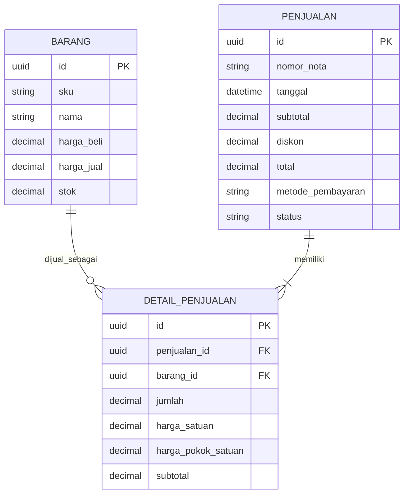

## [Buka Demo Aplikasi Toko Budi Sembako](https://budidarmadji03-bit.github.io/Toko-Sembako/)

# Toko Budi Sembako

**Nama:** Budi Austiano Darmadji

**NIM:** 12030124140215

**Mata Kuliah:** Pengkodean dan Pemograman

**Kelas:** E

**Dosen Pengampu:** Dr. Totok Dewayanto, S.E., M.Si., Akt.

*Disusun untuk memenuhi Tugas Project UTS Pengkodean dan Pemograman.*

---

## Penjelasan Sistem

Toko Budi Sembako adalah aplikasi sistem informasi untuk membantu kegiatan operasional toko, mulai dari pengelolaan barang dan persediaan, transaksi penjualan, pencatatan pelanggan, hingga pemantauan ringkasan keuangan. Aplikasi menyediakan dashboard untuk melihat aktivitas toko dan peringatan stok.

Login Owner dan Pelanggan menggunakan Supabase Auth dan role dari `public.profiles`. Data operasional disimpan di Supabase PostgreSQL, transaksi kasir/stok/pesanan menggunakan RPC transaksional, dan foto produk disimpan di Supabase Storage.

## Fitur

- **Dashboard:** ringkasan penjualan harian, grafik penjualan tujuh hari, jumlah barang, nilai persediaan, dan peringatan stok minimum.
- **Persediaan:** melihat, mencari, dan menyaring barang; menambah, mengubah, atau menonaktifkan barang; mencatat stok masuk; serta impor massal CSV dengan validasi SKU, harga, jumlah, dan batas minimum.
- **Foto produk:** Owner dapat mengunggah JPG/PNG/WebP maksimal 4 MB, melihat pratinjau, dan mengganti foto; foto dikompres sebelum diunggah ke bucket Supabase `product-photos`. Pratinjau DEMO dapat menambah foto lokal yang tidak masuk ke database produksi.
- **Kasir:** membuat keranjang penjualan, memilih pelanggan, menerapkan diskon, memilih metode pembayaran, dan memvalidasi pembayaran serta kembalian.
- **Cetak nota:** Owner dapat mencetak nota dari dashboard dan riwayat penjualan; pelanggan dapat mencetak nota dari riwayat pesanan. Nota memuat detail barang, nominal, status, serta alamat/tanggal pengiriman bila tersedia.
- **Pelanggan:** melihat, mencari, menambah, mengubah, dan menghapus data pelanggan.
- **Laporan usaha:** menyaring periode dan melihat laba rugi operasional, penjualan per barang setelah alokasi diskon, metode pembayaran, beban per kategori, pembelian, mutasi stok, dan valuasi persediaan saat ini. Ekspor Excel memiliki lembar terpisah untuk rincian laporan tersebut.
- **Ekspor:** mengunduh data persediaan dan pelanggan serta laporan sebagai CSV atau Excel (`.xlsx`).
- **Pembatalan transaksi:** pembatalan penjualan kasir memulihkan stok melalui RPC; pesanan antar memakai alur penolakan/kegagalan sendiri agar stok tidak dipulihkan dua kali.
- **Login dua role:** autentikasi Supabase Auth, pembacaan role dari `public.profiles`, pengalihan dashboard Owner/portal Pelanggan, registrasi yang selalu membuat role `customer`, dan logout.
- **Portal pelanggan:** katalog, foto/harga jual, profil, keranjang, alamat pengantaran, checkout, dan riwayat pesanan.
- **Pesanan antar:** checkout memesan stok; Owner mengubah status berurutan menjadi Sedang Diproses, Dalam Pengiriman, lalu Sudah Sampai atau Gagal Dikirim. Tanggal pengiriman dan status tersimpan di Supabase; penolakan/kegagalan melepaskan stok satu kali.
- **Riwayat transaksi:** dashboard Owner menampilkan seluruh transaksi tujuh hari kalender terakhir dari Supabase beserta tanggal, nomor transaksi, pelanggan, total, metode pembayaran, dan status.
- **Penyimpanan terintegrasi:** katalog, stok, pelanggan, penjualan, detail penjualan, pembelian, beban, dan pesanan dibaca dari Supabase; perubahan stok transaksi berjalan atomik melalui RPC.

## Logika Akuntansi

- **Penjualan bersih** dihitung dari total transaksi selesai. Transaksi yang dibatalkan tidak dihitung sebagai penjualan.
- **HPP (Harga Pokok Penjualan)** dijumlahkan berdasarkan snapshot biaya barang pada detail transaksi. Biaya persediaan diperbarui dengan metode rata-rata tertimbang bergerak saat stok masuk; transaksi lama tanpa snapshot HPP tetap memerlukan peninjauan dan tidak boleh dianggap sebagai nilai historis yang pasti.
- **Laba kotor** = penjualan bersih − HPP.
- **Laba bersih** = laba kotor − beban operasional yang dicatat.
- **Pembelian stok** dilaporkan sebagai pembelian persediaan, bukan langsung sebagai beban laba rugi. Ringkasan arus kas saat ini mengasumsikan seluruh stok masuk dibayar langsung; karena status tunai/kredit belum dicatat, angka tersebut bukan laporan arus kas yang andal untuk transaksi kredit atau pembayaran sebagian.
- **Arus kas bersih sederhana** saat ini = penerimaan penjualan − nilai pembelian stok − beban operasional, dengan asumsi pembayaran tunai saat transaksi.
- Diskon ditampilkan terpisah dari ringkasan penjualan. Catat beban operasional agar perhitungan laba bersih mencerminkan biaya yang dimasukkan.

Perhitungan ini merupakan ringkasan operasional sederhana, bukan sistem akuntansi double-entry. Pencatatan pembelian dan arus kas saat ini tidak membedakan pembelian tunai/kredit maupun pembayaran sebagian. Jangan gunakan laporan tersebut sebagai laporan keuangan final atau pengganti pembukuan resmi/pelaporan pajak sebelum modul akuntansi dan kontrol akses selesai.

Impor barang memakai template yang diunduh dari halaman Persediaan. Isi harga dan saldo stok berdasarkan data yang benar sebelum impor; sistem memvalidasi semua baris dan SKU terlebih dahulu, membatasi 500 produk per berkas, lalu meminta konfirmasi sebelum mengirim ke Supabase. Data awal produk akan menghasilkan mutasi saldo awal sesuai trigger database.

Laporan mutasi persediaan dibatasi tanggal laporan. Laporan valuasi persediaan selalu memakai saldo dan biaya rata-rata tercatat saat ini, bukan rekonstruksi saldo historis. Laporan usaha belum mencakup neraca, saldo awal akuntansi, utang/piutang, aset tetap, pajak, atau jurnal double-entry; jangan menganggapnya laporan keuangan lengkap atau klaim kepatuhan PSAK.

## ERD Inti (3 Entitas)



`DETAIL_PENJUALAN` menyimpan baris barang dalam nota dan menghubungkan `PENJUALAN` dengan `BARANG`. Satu penjualan memiliki satu atau lebih detail; satu barang dapat muncul di banyak detail. Entitas lain seperti pelanggan, mutasi persediaan, pembelian stok, dan beban operasional mendukung fitur aplikasi, tetapi tidak ditampilkan dalam ERD inti ini.

## Struktur Folder

```text
.
├── .github/
│   └── workflows/
│       └── deploy-pages.yml   # Publikasi demo ke GitHub Pages
├── backend/
│   └── sql/
│       ├── 01_schema.sql      # Tabel, relasi, indeks, dan kebijakan database
│       ├── 02_rpc.sql         # Fungsi transaksi dan perubahan stok
│       ├── 03_seed.sql        # Data awal/contoh barang
│       ├── 04_customer_portal.sql # Profil pelanggan, RLS, dan checkout pelanggan
│       ├── 05_auth_profiles.sql   # Trigger profil dan hardening RLS profil
│       ├── 06_app_operations.sql  # Storage foto, penyesuaian stok, dan status pesanan awal
│       ├── 07_delivery_tracking.sql # Status pengiriman dan tanggal kirim
│       └── 08_guest_checkout.sql # Checkout tanpa akun, reservasi stok, dan pelacakan privat
├── frontend/
│   ├── index.html             # Beranda belanja tamu terintegrasi, login, dan pratinjau
│   ├── css/
│   │   └── style.css          # Tampilan dan tata letak responsif
│   ├── html/
│   │   ├── index.html         # Halaman utama aplikasi
│   │   ├── login.html         # Login Supabase dan registrasi pelanggan
│   │   ├── customer.html      # Katalog dan pesanan pelanggan dengan akun
│   │   └── customer-guest.html # Katalog/checkout Supabase tanpa akun pelanggan
│   └── js/
│       ├── app.js             # Navigasi Owner, kasir, persediaan, pesanan antar, laporan
│       ├── customer.js        # Katalog, profil, checkout antar, dan riwayat pesanan
│       ├── customer-guest.js  # Checkout tamu, reservasi stok, dan pelacakan berkode
│       ├── config.js          # Project URL dan publishable/anon key publik
│       ├── supabase-auth.js   # Supabase Auth, pemuatan profil, dan role check
│       └── login.js           # Validasi form, status, error, dan redirect role
└── README.md
```

## Teknologi

- HTML5, CSS3, dan JavaScript tanpa framework/build step.
- Supabase JavaScript SDK v2 melalui CDN untuk Auth, PostgreSQL REST/RPC, dan Storage; sesi dikelola dan diperiksa ulang oleh SDK.
- Row Level Security membatasi data operasional kepada Owner dan data profil/pesanan milik Pelanggan.
- SheetJS Community Edition untuk membuat file Excel `.xlsx`.
- GitHub Pages dan GitHub Actions untuk menerbitkan demo statis.
- Font Awesome, Google Fonts, dan Unsplash untuk ikon, tipografi, serta gambar.

## Menjalankan Secara Lokal

1. Sajikan folder `frontend` lewat HTTPS atau localhost (misalnya VS Code Live Server). Jangan membuka HTML langsung dengan `file://`.
2. Di Supabase Dashboard, buka **Project Settings → API**. Konfigurasi `projectUrl` dan `publishableKey` di `frontend/js/config.js` dengan project URL dan publishable/anon key. Nilai ini memang publik untuk browser; jangan gunakan `service_role` atau secret key. `.env.example` hanya dokumentasi placeholder—GitHub Pages statis tidak memuat `.env`.
3. Di SQL Editor, jalankan migrasi berurutan `backend/sql/01_schema.sql`, `02_rpc.sql`, `04_customer_portal.sql`, `05_auth_profiles.sql`, `06_app_operations.sql`, lalu (setelah ditinjau dan disetujui) `07_delivery_tracking.sql` dan `08_guest_checkout.sql`. Migrasi `08` memberikan akses baca anon hanya ke view katalog serta izin execute pada RPC checkout/pelacakan; migrasi ini tidak memberi akses tulis anon langsung ke tabel penjualan/stok. RPC membuat pesanan `menunggu`, mereservasi stok secara atomik, dan menahan status pembayaran sebagai belum lunas sampai Owner menyelesaikan pesanan. Kode pelacakan adalah rahasia akses pesanan—jangan bagikan ke orang lain. Batas dasar membatasi lima checkout per nomor dalam 15 menit, tetapi nomor telepon dapat dipalsukan; untuk deployment publik, tambahkan CAPTCHA/server-side abuse protection. Jangan jalankan migrasi pada database produksi sebelum meninjau skema dan memastikan backup. Jalankan `03_seed.sql` hanya jika produk contoh memang diinginkan dan belum ada.
   Sebelum menjalankan migrasi `07`, jalankan pemeriksaan baca-saja berikut untuk mencocokkan constraint dan nilai status yang sudah ada:

   ```sql
   select conname, pg_get_constraintdef(oid) as definition
   from pg_constraint
   where conrelid = 'public.penjualan'::regclass and contype = 'c'
   order by conname;

   select status, status_pembayaran, status_pemenuhan, count(*) as jumlah
   from public.penjualan
   group by status, status_pembayaran, status_pemenuhan
   order by status, status_pembayaran, status_pemenuhan;
   ```

   Hasil pemeriksaan ini tidak mengubah data. Pastikan definisi constraint cocok sebelum menyetujui migrasi status pengiriman.
4. Pastikan Supabase Authentication mengizinkan Email/Password dan atur Site URL serta redirect URL untuk localhost atau domain deployment.
5. Periksa **Authentication → Users** untuk memastikan akun benar-benar terdaftar. Alamat/password contoh pada prompt tidak membuktikan akun ada; repo tidak dapat membaca daftar pengguna proyek.
6. Registrasi halaman login hanya membuat Pelanggan. Trigger memberi profil baru role `customer`. Untuk Owner, buat/undang akun melalui Supabase Auth, verifikasi UUID pengguna, lalu ubah role profil melalui SQL Editor sebagai administrator tepercaya saja.
7. Masuk dari halaman login. Profil dan role dibaca dari `public.profiles`; Owner diarahkan ke `html/index.html`, Pelanggan ke `html/customer.html`. Tombol **Keluar** mengakhiri sesi Supabase.

### Audit dan pemulihan login

- Kode login memanggil `signInWithPassword`; `frontend/js/local-auth.js` tidak dipakai oleh halaman aplikasi.
- Jika kredensial ditolak, periksa **Authentication → Users**, proyek yang benar, dan status konfirmasi email. Jika akun ada tetapi password tidak diketahui, gunakan **Lupa password?** pada halaman login; tautan pemulihan harus kembali ke halaman aplikasi yang diizinkan pada **Authentication → URL Configuration**. Untuk aplikasi yang dibuka sebagai `file://`, Supabase memakai Site URL proyek.
- Tautan reset password membawa sesi pemulihan ke halaman login untuk menetapkan kata sandi baru. Respons pendaftaran tanpa sesi belum selalu membuktikan akun baru dibuat (misalnya email sudah terdaftar); periksa **Authentication → Users** dan gunakan pemulihan password bila perlu.
- Undangan Owner/Pelanggan harus dibuka dari email pada domain aplikasi yang sudah diterbitkan. Halaman akar meneruskan token undangan ke formulir aktivasi; pengguna membuat password sendiri sebelum masuk.
- Jika profil tidak ditemukan, jalankan `05_auth_profiles.sql` setelah migrasi sebelumnya. Migrasi hanya membuat profil yang hilang sebagai `customer`; profil/role yang sudah ada tidak diubah.
- Jika produk berhasil disimpan tetapi unggahan foto ditolak, pastikan migrasi `06_app_operations.sql` sudah selesai dijalankan di proyek Supabase yang sama. Migrasi ini membuat bucket privat-terbatas `product-photos` beserta kebijakan baca publik dan kebijakan unggah/hapus khusus Owner. Periksa **Storage → Buckets** dan login dengan akun ber-role `owner`; jangan memasukkan service-role key ke aplikasi.
- Untuk mengaktifkan status Dalam Pengiriman, Sudah Sampai, dan Gagal Dikirim serta tanggal pengiriman, tinjau lalu jalankan `07_delivery_tracking.sql` setelah migrasi `01`–`06`. Kegagalan pengiriman mengembalikan stok pesanan melalui transaksi database; status final tersebut tidak dapat diproses ulang dari UI.
- Checkout tanpa akun memakai `frontend/html/customer-guest.html`; setelah `08_guest_checkout.sql` dijalankan, pesanan muncul di menu Owner **Pesanan Antar** dan stok direservasi. Pelanggan menyimpan token/kode pelacakan privat untuk memeriksa status tanpa membuka data pesanan lain.
- Untuk Owner, identifikasi UUID yang benar di Dashboard terlebih dahulu, lalu tetapkan role hanya melalui SQL Editor:

  ```sql
  select id, email from auth.users where lower(email)=lower('<email-owner>');
  select id, role from public.profiles where id='<uuid-yang-sudah-diverifikasi>';
  update public.profiles set role='owner' where id='<uuid-yang-sudah-diverifikasi>';
  ```

- Periksa akun tanpa profil atau role tak valid sebelum validasi constraint:

  ```sql
  select u.id, u.email, p.role
  from auth.users u
  left join public.profiles p on p.id=u.id
  where p.id is null or p.role not in ('owner','customer');
  ```

- Setelah data lama ditinjau dan diperbaiki secara administratif, jalankan `alter table public.profiles validate constraint profiles_role_allowed_check;`.

### Pengujian alur Owner, Pelanggan, dan pengantaran

- Gunakan akun yang benar-benar tercantum di **Authentication → Users**; jangan anggap email/password contoh sudah terdaftar.
- Login sebagai Owner dengan profil ber-role `owner`; pastikan diarahkan ke dashboard.
- Keluar lalu login sebagai Pelanggan dengan profil ber-role `customer`; pastikan diarahkan ke katalog. Buka URL dashboard Owner secara langsung dan pastikan dialihkan kembali ke portal pelanggan.
- Uji password salah, akun tidak terdaftar, profil hilang, role tidak valid, refresh sesi, dan logout. UI tidak mencetak password, token, atau key.
- Daftarkan Pelanggan baru dan pastikan trigger database memberi role `customer`, tanpa menerima role dari form.
- Setelah uji autentikasi, pilih produk dan lengkapi penerima, nomor telepon, dan alamat pengantaran.
- Buat pesanan. Pastikan status **Menunggu konfirmasi**, stok katalog berkurang, dan pesanan muncul pada riwayat akun pelanggan pembuatnya.
- Masuk sebagai Owner pada sesi lain. Ubah status secara berurutan: **Sedang Diproses** → **Dalam Pengiriman** → **Sudah Sampai**; periksa tanggal pengiriman dan status pada riwayat pelanggan.
- Untuk pesanan dalam pengiriman, uji **Gagal Dikirim** dan pastikan stok kembali tepat satu kali serta status gagal tampil pada riwayat pelanggan.
- Uji penolakan Owner dan pembatalan pelanggan saat status masih menunggu. Stok harus kembali tepat satu kali. Pelanggan tidak dapat membatalkan pesanan yang telah diproses.
- Uji reload, logout, dan pengalihan halaman langsung pada kedua role.

GitHub Pages menerbitkan isi folder `frontend` melalui GitHub Actions. Setelah workflow deployment berhasil dan migrasi `08_guest_checkout.sql` diterapkan, gunakan tautan aplikasi di bagian paling atas README ini. Beranda menyediakan checkout tamu terintegrasi, jalur login pelanggan, login Owner, dan pratinjau DEMO terpisah.

## Catatan Penting

- Aplikasi memerlukan semua migrasi SQL di atas dan akun dengan role Supabase yang benar sebelum fitur operasional tersedia.
- Data operasional tersinkron lewat Supabase; akses database tetap dibatasi RLS. Backup dan pembayaran elektronik tidak termasuk.
- Role Owner ditentukan oleh `public.profiles.role` dan dibatasi oleh grant/RLS database; role tidak boleh berasal dari email atau input pengguna.
- SheetJS, ikon, font, dan gambar eksternal memerlukan koneksi internet. Ekspor CSV tetap disediakan sebagai alternatif Excel.
- Tinjau metode HPP, pajak, audit trail, pencadangan, dan prosedur pembatalan sebelum menggunakan aplikasi sebagai sistem pembukuan resmi.
