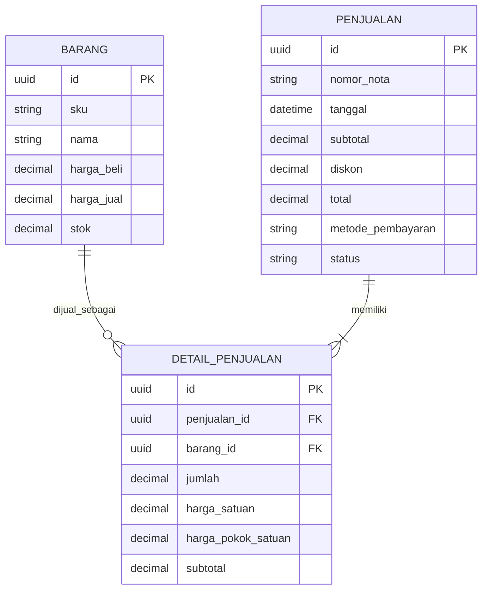

# Toko Sembako

Sistem informasi penjualan, persediaan, pelanggan, dan laporan keuangan toko sembako. Aplikasi menggunakan HTML, CSS, JavaScript, dan Supabase JS v2; tidak memerlukan npm atau proses build.

## Fitur

- Dashboard penjualan harian, grafik 7 hari, nilai stok, dan peringatan stok minimum.
- Persediaan: pencarian, filter, tambah/edit/nonaktifkan barang, stok masuk, dan ekspor CSV.
- Kasir: keranjang, pelanggan, diskon, metode pembayaran, validasi pembayaran, dan kembalian.
- Pelanggan: tambah, edit, cari, hapus, dan ekspor CSV.
- Ekspor data persediaan dan pelanggan ke CSV maupun workbook Excel `.xlsx`; laporan keuangan tersedia sebagai CSV dan workbook lima sheet.
- Laporan keuangan dengan filter periode: penjualan bersih, diskon, harga pokok penjualan (HPP), laba kotor, beban operasional, laba bersih, pembelian persediaan, arus kas bersih, ringkasan laba rugi, rincian pembayaran, transaksi, pembelian, serta beban.
- Ekspor laporan keuangan gabungan ke CSV dan pembatalan transaksi dengan pemulihan stok.
- Mode demo menyimpan data pada browser. Data demo tidak disinkronkan ke Supabase.

## ERD inti (3 entitas)

`DETAIL_PENJUALAN` adalah entitas penghubung/baris transaksi: satu penjualan memiliki satu atau lebih detail, dan satu barang dapat muncul di banyak detail. Tabel `PELANGGAN`, `MUTASI_PERSEDIAAN`, `PEMBELIAN_STOK`, dan `BEBAN_OPERASIONAL` mendukung fitur aplikasi, tetapi tidak ditampilkan dalam ERD inti tiga entitas di atas.

## Menjalankan

1. Buka folder proyek di VS Code.
2. Untuk database online, buat proyek Supabase dan buka SQL Editor.
3. Jalankan `backend/sql/01_schema.sql`, lalu `backend/sql/02_rpc.sql`; jalankan `backend/sql/03_seed.sql` bila ingin memuat contoh barang.
4. Jika proyek Supabase sudah pernah disiapkan, jalankan kembali kedua skrip schema dan RPC tersebut agar tabel laporan keuangan dan fungsi pencatatan stok masuk terbaru tersedia. Pastikan semua perintah berhasil tanpa error di SQL Editor.
5. Buka `frontend/html/index.html` dengan Live Server. Tanpa Supabase, aplikasi otomatis menggunakan mode demo.
6. Untuk Supabase, buka **Pengaturan Supabase** di aplikasi dan masukkan Project URL serta publishable/anon key.

Ekspor Excel menggunakan SheetJS Community Edition dari CDN resminya; perangkat perlu terhubung ke internet saat halaman dibuka. Tombol ekspor CSV tetap tersedia.

## Dasar perhitungan laporan

- Penjualan bersih adalah total nota berstatus selesai; nota yang dibatalkan tidak masuk laba dan diskon ditampilkan terpisah.
- HPP dijumlahkan dari harga pokok yang disimpan pada setiap detail saat barang terjual. Untuk data transaksi lama tanpa detail/snapshot HPP, mode lokal memperkirakan memakai harga beli barang saat ini.
- Laba kotor = penjualan bersih − HPP. Laba bersih = laba kotor − beban operasional yang dicatat.
- Pembelian persediaan dilaporkan sebagai pengeluaran kas, bukan langsung sebagai beban laba rugi. Arus kas bersih sederhana = penerimaan penjualan − pembelian persediaan − beban operasional.
- Laporan ini adalah ringkasan operasional sederhana, bukan pengganti pembukuan pajak atau laporan akuntansi formal. Pengeluaran harus dicatat agar laba bersih mencerminkan biaya toko.

## Keamanan dan batasan

- Gunakan hanya publishable/anon key di browser; jangan pernah menggunakan `service_role`.
- SQL menyediakan policy akses publik untuk demo/pengembangan. Sebelum penggunaan produksi, ganti policy RLS dengan kebijakan berbasis pengguna/role, aktifkan autentikasi, dan lakukan audit keamanan.
- Penjualan, pembatalan, dan stok masuk memakai RPC database agar perubahan stok serta pencatatan terkait berjalan atomik.
- Tinjau metode HPP, pajak, hak akses, audit trail, backup, dan prosedur pembatalan bersama pengelola/akuntan sebelum menjadikan aplikasi sebagai pembukuan resmi.
