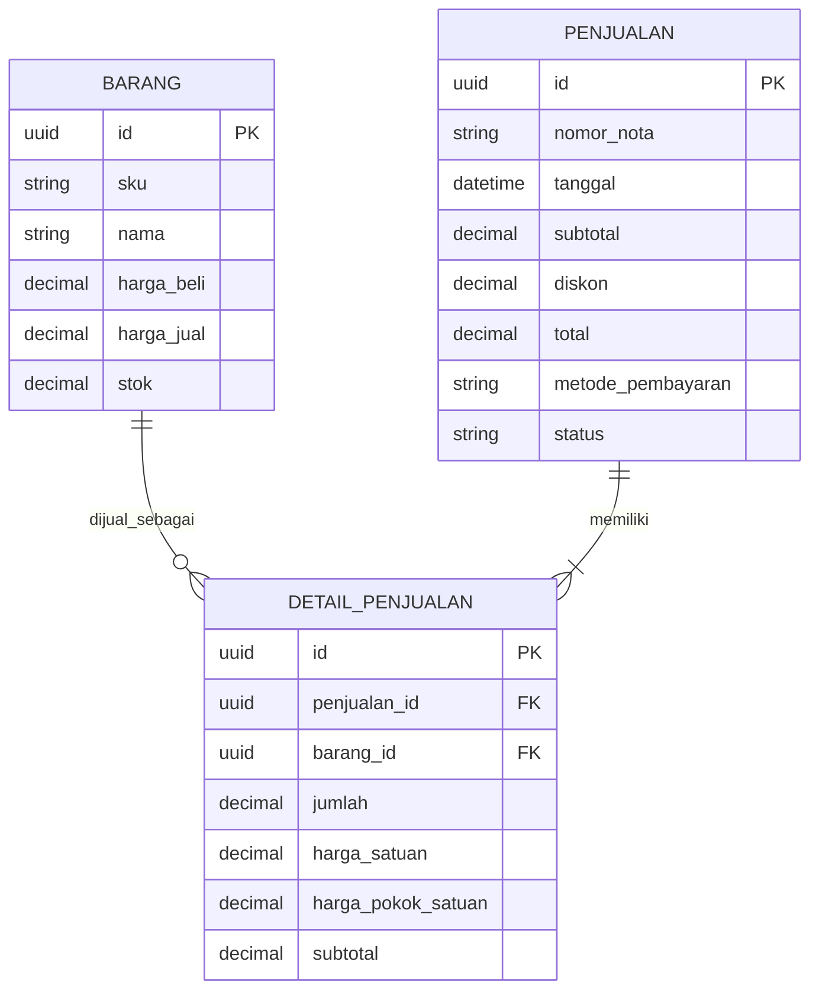

## [Buka Demo Aplikasi Toko Budi Sembako](https://budidarmadji03-bit.github.io/Toko-Sembako/)

# Toko Budi Sembako

**Nama:** Budi Austiano Darmadji

**NIM:** 12030124140215

**Mata Kuliah:** Pengkodean dan Pemograman

**Kelas:** E

**Dosen Pengampu:** Dr. Totok Dewayanto, S.E., M.Si., Akt.

*Disusun untuk memenuhi Tugas Project UTS Pengkodean dan Pemograman.*

---

## Penjelasan Sistem

Toko Budi Sembako adalah aplikasi sistem informasi untuk membantu kegiatan operasional toko, mulai dari pengelolaan barang dan persediaan, transaksi penjualan, pencatatan pelanggan, hingga pemantauan ringkasan keuangan. Aplikasi menyediakan dashboard untuk melihat aktivitas toko dan peringatan stok.

Demo yang di-host di GitHub Pages berjalan sebagai aplikasi web statis. Secara default, data demo disimpan di penyimpanan browser dan tidak otomatis tersinkron dengan database. Supabase dapat dikonfigurasikan secara terpisah untuk penyimpanan online setelah skema database disiapkan.

## Fitur

- **Dashboard:** ringkasan penjualan harian, grafik penjualan tujuh hari, jumlah barang, nilai persediaan, dan peringatan stok minimum.
- **Persediaan:** melihat, mencari, dan menyaring barang; menambah, mengubah, atau menonaktifkan barang; serta mencatat stok masuk.
- **Kasir:** membuat keranjang penjualan, memilih pelanggan, menerapkan diskon, memilih metode pembayaran, dan memvalidasi pembayaran serta kembalian.
- **Pelanggan:** melihat, mencari, menambah, mengubah, dan menghapus data pelanggan.
- **Laporan keuangan:** menyaring periode dan melihat penjualan, HPP, laba kotor, beban operasional, laba bersih, pembelian stok, arus kas, transaksi, dan metode pembayaran.
- **Ekspor:** mengunduh data persediaan dan pelanggan serta laporan sebagai CSV atau Excel (`.xlsx`).
- **Pembatalan transaksi:** membatalkan transaksi dan memulihkan stok sesuai pencatatan aplikasi.
- **Mode demo:** mencoba fitur tanpa menghubungkan database; data demo tersimpan di browser yang digunakan. Pada browser baru, aplikasi mengisi data contoh penjualan, pembelian stok, dan beban operasional agar laporan dapat dilihat langsung.

## Logika Akuntansi

- **Penjualan bersih** dihitung dari total transaksi selesai. Transaksi yang dibatalkan tidak dihitung sebagai penjualan.
- **HPP (Harga Pokok Penjualan)** dijumlahkan berdasarkan harga pokok barang pada detail transaksi. Untuk transaksi lama tanpa snapshot HPP, mode lokal dapat memperkirakan HPP menggunakan harga beli barang saat ini.
- **Laba kotor** = penjualan bersih − HPP.
- **Laba bersih** = laba kotor − beban operasional yang dicatat.
- **Pembelian stok** dilaporkan sebagai arus kas keluar untuk persediaan, bukan langsung sebagai beban laba rugi.
- **Arus kas bersih sederhana** = penerimaan penjualan − pembelian stok − beban operasional.
- Diskon ditampilkan terpisah dari ringkasan penjualan. Catat beban operasional agar perhitungan laba bersih mencerminkan biaya yang dimasukkan.

Perhitungan ini merupakan ringkasan operasional sederhana, bukan pengganti pembukuan resmi, pelaporan pajak, atau laporan akuntansi yang telah ditelaah profesional.

## ERD Inti (3 Entitas)



`DETAIL_PENJUALAN` menyimpan baris barang dalam nota dan menghubungkan `PENJUALAN` dengan `BARANG`. Satu penjualan memiliki satu atau lebih detail; satu barang dapat muncul di banyak detail. Entitas lain seperti pelanggan, mutasi persediaan, pembelian stok, dan beban operasional mendukung fitur aplikasi, tetapi tidak ditampilkan dalam ERD inti ini.

## Struktur Folder

```text
.
├── .github/
│   └── workflows/
│       └── deploy-pages.yml   # Publikasi demo ke GitHub Pages
├── backend/
│   └── sql/
│       ├── 01_schema.sql      # Tabel, relasi, indeks, dan kebijakan database
│       ├── 02_rpc.sql         # Fungsi transaksi dan perubahan stok
│       └── 03_seed.sql        # Data awal/contoh barang
├── frontend/
│   ├── index.html             # Pengarah ke halaman aplikasi
│   ├── css/
│   │   └── style.css          # Tampilan dan tata letak responsif
│   ├── html/
│   │   ├── index.html         # Halaman utama aplikasi
│   │   └── login.html         # Halaman login opsional Supabase Auth
│   └── js/
│       ├── app.js             # Navigasi, kasir, persediaan, laporan, ekspor
│       └── config.js          # Konfigurasi klien Supabase di browser
└── README.md
```

## Teknologi

- HTML5, CSS3, dan JavaScript tanpa framework/build step.
- Supabase JS v2 untuk integrasi database dan autentikasi opsional.
- PostgreSQL dan PL/pgSQL untuk skema serta fungsi RPC Supabase.
- SheetJS Community Edition untuk membuat file Excel `.xlsx`.
- GitHub Pages dan GitHub Actions untuk menerbitkan demo statis.
- Font Awesome, Google Fonts, dan Unsplash untuk ikon, tipografi, serta gambar.

## Menjalankan Secara Lokal

1. Clone repositori dan buka folder proyek di VS Code.
2. Sajikan folder `frontend` dengan server statis, misalnya ekstensi Live Server.
3. Buka `html/index.html` pada server tersebut. Demo dapat digunakan tanpa konfigurasi Supabase; datanya disimpan di browser.
4. Untuk menggunakan database online, buat proyek Supabase dan buka SQL Editor.
5. Jalankan `backend/sql/01_schema.sql`, lalu `backend/sql/02_rpc.sql`. Jalankan `backend/sql/03_seed.sql` jika ingin memasukkan contoh barang.
6. Pastikan semua skrip sukses dijalankan. Pada aplikasi, buka **Pengaturan Supabase** dan masukkan Project URL serta publishable/anon key.

GitHub Pages menerbitkan isi folder `frontend` melalui GitHub Actions. Setelah workflow deployment berhasil, gunakan tautan demo di bagian paling atas README ini.

## Catatan Penting

- Mode demo menyimpan data secara lokal di browser/perangkat yang digunakan; data tersebut tidak dibagikan ke pengguna atau browser lain.
- Data dummy hanya untuk demonstrasi, bukan transaksi nyata. Data itu dibuat sekali saat mode demo pertama kali dibuka pada browser baru; data demo yang sudah ada tidak ditimpa.
- Supabase belum otomatis terhubung hanya dengan membuka demo. Database memerlukan konfigurasi proyek dan seluruh skrip SQL berhasil dijalankan.
- Jangan menaruh `service_role` key, kata sandi, atau rahasia lain di frontend maupun repositori. Gunakan hanya publishable/anon key di browser.
- Kebijakan SQL untuk demo/pengembangan dapat memberikan akses publik. Sebelum digunakan untuk data nyata, terapkan autentikasi dan RLS berbasis pengguna/role, lalu tinjau hak akses.
- SheetJS, Supabase JS, ikon, font, dan gambar eksternal memerlukan koneksi internet. Ekspor CSV tetap disediakan sebagai alternatif Excel.
- Tinjau metode HPP, pajak, audit trail, pencadangan, dan prosedur pembatalan sebelum menggunakan aplikasi sebagai sistem pembukuan resmi.
